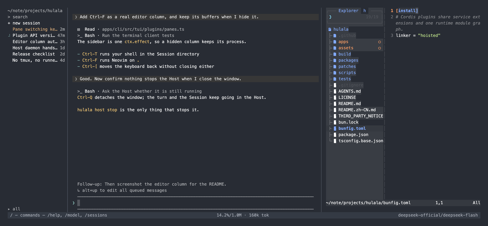
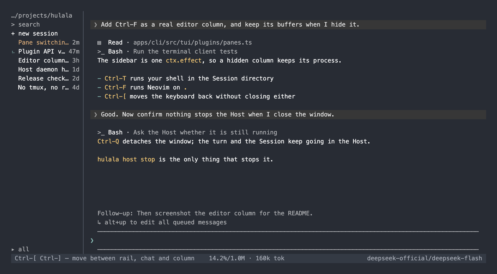
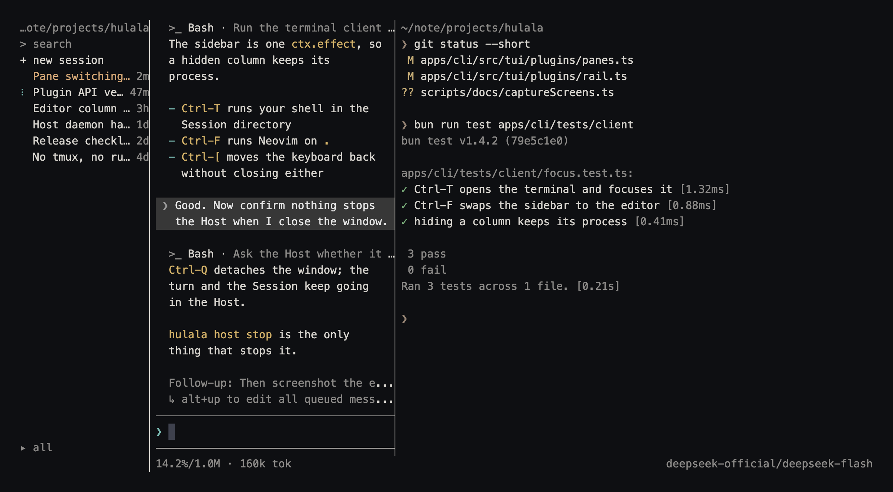

<div align="center">
  
  <h1>Hulala</h1>
  <p>跑在你本地的 DeepSeek Harness 个人 Agent。</p>
  <p>一个跑在你自己机器上的 TUI：Agent、Neovim、真实 shell，还有一个你永远不用看着的守护进程。</p>
  <p><a href="README.md">English</a> · <a href="https://hulala.ai/zh-CN/">官网</a></p>
</div>

Hulala 把 [DeepSeek Harness](https://github.com/deepseek-ai/deepseek-harness) 放进终端，
并把整个客户端交给你：引擎就是 DSH 自己的 Agent Loop，每个面板都是本仓组装的插件，
而 Host 原样接受 DSH 插件。

## 安装

```sh
curl -fsSL https://hulala.ai/install.sh | sh
```

装完在任意终端运行 `hulala`——shell 还没读到新命令时，安装器会替你启动它。
支持 macOS（Apple 芯片与 Intel）和 Linux（x64 与 arm64），Windows 尚未实现。
Neovim 和 ripgrep 随包自带，需要的 Node.js 也由安装器提供，先装什么都不用。
代理、Node.js 兜底、`hulala update`、`hulala rollback`，以及 `$HULALA_HOME` 里
到底放了什么，见[安装细节](#安装细节)。

<p align="center">
  
  <br />
  <sub><code>Ctrl-D</code>：在会话目录上打开 Neovim——内置文件树、从树里打开的文件，列隐藏时缓冲区还在。</sub>
</p>

`Ctrl-D` 是在会话目录上打开编辑器，所以它同时也是文件树：内置的浏览器
（`apps/cli/vendor/snacks.nvim`）替代了 netrw，选中文件就在同一列里、树的旁边打开。

<p align="center">
  
  <br />
  <sub>整个帧：左侧会话栏、带工具行的对话、排队的消息和下面的 composer。</sub>
</p>

## 特性

- **一个窗口三列** —— 左边会话栏，中间对话，右边一个侧栏：`Ctrl+T` 是内置终端，
  `Ctrl-G` 是 Neovim，`Ctrl-Shift-G` 只留 Neovim。
- **不需要 tmux，也不需要启动脚本** —— Host 本身就是守护进程。每个窗口都是连到它的
  客户端，`Ctrl-Q` 只是断开，turn 继续跑。
- **自带 Neovim 和 ripgrep** —— 什么都不用装。每个内置二进制都是 `$HULALA_HOME/bin`
  下的真实文件，`bin/` 是追加到子进程 `PATH` 的，所以你自己装的工具仍然优先。
- **会话目录里的真实 shell** —— 右列是一个完整 pty；列收起来，作业和缓冲区都还在。
- **用的是 Harness 原生面，不是抄一套** —— 流式输出、审批、提问、选模型、取消，以及
  `/connect`、`/api`、`/api/remote.mux`。
- **插件就是 DSH 插件** —— `hulala plugin --profile tui add <包名>` 装进 Host 的 profile，
  没有 `node_modules`。
- **Telegram 和飞书里也能对话** —— `hulala install bot` 把一段聊天挂到一个 Session 上，
  同一个 agent、同一个状态根目录也能从手机上回你。见[聊天机器人](#聊天机器人)。
- **`Ctrl-V` 粘贴的是路径，和 pi 一样** —— 截图、Finder 里复制的文件或纯文本都按文本
  进入输入框。图片和复制来的文件先存到 Host 自己的临时目录
  （`$TMPDIR/hulala-pastes/`，Linux 上是 `/tmp/hulala-pastes/`，由操作系统回收），所以
  输入框里的路径是模型真的能打开的那个文件——本机如此，`hulala ssh` 到远端时也一样，
  落在它真正运行的那台机器上。
- **窗口可以直接开在另一台机器上** —— `hulala ssh <host>` 把这个窗口开到那台机器的
  Host 上：alias 是你自己的 `~/.ssh/config`，密钥是你已经在用的，剪贴板是这一台的，
  而 shell 和 Neovim 在那边跑。见[窗口开到另一台机器上](#窗口开到另一台机器上)。
- **Creator mode** —— agent 拿到 Host 自己 Cordis 面的只读视图和检查它的工具，能对着
  活着的组合回答问题、扩展它。

## 不需要 tmux

`hulala` 不是那种每个窗口启动一个、关窗就没了的程序。一个 Host 守护进程拥有状态根目录；
每个终端窗口都是连到那个进程的客户端，想开几个开几个。

```sh
hulala host start        # 这个状态根目录唯一的 Host，detached
hulala                   # 附着窗口 —— 开几个终端都行
hulala host status       # 守护进程现在的状态
hulala host stop         # 唯一能停掉它的东西
```

客户端通过状态根目录里的 `endpoint.json` 找到守护进程，所以健康的 Host 在响应时，
第二个窗口不会偷偷起一个自己的。关窗（`Ctrl-Q`）只是断开：模型调用、工具调用和
Session 都还在跑，下个窗口接着停的地方继续。`tmux`、`nohup`、裸 `&` 就是在手搜这件事；
这里是程序默认的行为，而 `hulala host stop` 是明确的终止方式。

<p align="center">
  
  <br />
  <sub><code>Ctrl-T</code>：内置终端——会话目录里你自己的 shell，带自己的回滚历史。</sub>
</p>


## 窗口开到另一台机器上

`hulala ssh <host>` 把这个窗口开到那台机器的 Host 上，`<host>` 就是你平时 ssh 的
那个 alias：列表来自你自己的 `~/.ssh/config`，认证就是你已经有的 ssh——密钥、agent、
`ProxyJump`、证书。没有它自己的密码框，也不在任何地方开端口：Host 仍然只 bind
loopback，客户端通过一条转发出来的 socket 够到它。

```sh
hulala ssh devbox        # 同一个命令的另一种写法：hulala remote devbox
hulala remote            # 列出 ~/.ssh/config 里的 alias
```

`/remote` 切换一个已经开着的窗口，`/remote local` 回到本机。本机只管界面那一半，
其余全在 Host 上，所以你坐的那台机器只需要有 `hulala`：

- **对面不用手动装** —— 客户端先探测；Hulala 没装或落后，就在那边跑同一个官网安装器、
  停掉旧 Host 再 attach；机器连不上、或者那边的 Host 比本机新，就只报告，不动它。
- **shell 和 Neovim 在那边跑** —— 那个状态根目录上的 pty 和真 Neovim，于是终端列带着
  远端机器的工具链，编辑列改的是远端机器上的树。不 clone、不 rsync、不挂载，第二台
  机器不需要自己装 Neovim。
- **剪贴板照样能用** —— `Ctrl-V` 读的是本机剪贴板；图片和复制来的文件先写到 Host 上
  （`$TMPDIR/hulala-pastes/`），插进草稿的就是那个路径，所以模型打开的是它工具所在那侧
  真实存在的文件。纯文本还是按文本贴。
- **配色还是这一台的** —— 客户端把自己终端的配色交给 Host，所以那边的 Neovim 用的是
  你坐着的这个窗口的主题，而不是远端机器自己的。
- **一个 Host，所有机器** —— Session、模型、凭据、插件、Cron 任务和 bot 都属于那个状态
  根目录，所以第二台笔记本接的是同一份工作，而不是另起一份。`Ctrl-Q` 只是断开，turn
  继续跑，下次 attach 接着看。
- **断线不会结束手上的活** —— 转发在原来的端口上重建、token 重新交换，所以睡过去的
  笔记本、换过的网络只是重连这个窗口；Host 被一次升级换掉了，就当作新进程重新 attach。

## 快捷键

整个帧不靠鼠标也能用：

| 按键 | 作用 |
|---|---|
| `Ctrl-D` | 会话栏：按一下把键盘交给它，再按一次收起，再按一次带着键盘打开（草稿留在原处） |
| `Ctrl-F` | 对话栏：按一下把键盘交给它；在 composer 里按则收起对话（会话栏或侧栏会撑住画面） |
| `Ctrl-T` | 内置终端列：按一下把键盘交给它，再按一次收起（shell 的作业继续跑） |
| `Ctrl-G` | Neovim 列：按一下把键盘交给它，再按一次请 Neovim 退出（改动没保存会先问你） |
| `Ctrl-Shift-G` | 只留 Neovim：收起会话栏和对话栏，编辑器列不动；再按一次恢复进入前的布局（需要 Kitty 键盘协议，或者用 `/nvim`） |
| `Shift-Cmd-K` | 命令面板：每条命令做什么、快捷键是什么；在任何列里、对话收起时都能打开 |
| `Ctrl-,` / `Ctrl-.` | 在任何焦点位置切到上一个 / 下一个会话（终端送不到逗号、句点的 Kitty 序列时用 `Ctrl-↑` / `Ctrl-↓`） |
| `Ctrl-Q` | 断开：窗口关掉，Host 把 turn 继续跑完 |
| `Esc` | 停掉正在跑的 turn；没有在跑时，进入会话栏 |
| `Ctrl-C` | 停掉正在跑的 turn；composer 空闲时先清空草稿，再按一次退出 |
| `Enter` | 发送；turn 在跑时用 `Alt-Enter` 排成下一个 turn |
| `Alt-Up` | 把排队的消息取回 composer |
| `Ctrl-O` | 展开当前指向的工具行 |
| `Shift-Tab` | 循环切换当前模型的思考等级；`/thinking` 打开等级选择器 |
| `Ctrl-S`（在 Neovim 列里） | 立刻写编辑器缓冲区（平时自动保存）——没有任何面板键是 Ctrl 加字母再加 Shift，所以这个字节归 Neovim |
| `Cmd-L` / `Ctrl-Shift-L` | 丢掉渲染器对屏幕的记录、整屏重画：画面被丢掉的序列弄花时的手动补救（改窗口大小、重连、唤醒本来就会自动做一次） |
| `Cmd-Ctrl-[` / `Cmd-Ctrl-]` | 移动焦点列旁的分割线：右边那列变宽或变窄 |
| `Ctrl-Shift-[` / `Ctrl-Shift-]` | 同上；`Ctrl-Shift-←` / `Ctrl-Shift-→` 是任何终端都收得到的写法 |
| 拖动分割线 | 用指针做同一件事，两侧的线都可以拖 |
| `Shift-PgUp` / `Shift-PgDn` | 翻终端列自己的历史 |
| `↑` `↓` `j` `k` `Ctrl-P` `Ctrl-N` | 在列表里移动；`Tab` 补全，`Enter` 打开 |
| `/` | 命令：`/help`、`/sessions`、`/new`、`/model`、`/thinking`、`/editor`、`/terminal`、`/nvim`、`/rail`、`/chat`、`/keys`、`/cancel`、`/quit` |

每个面板一个键，这个键是一个循环：没拿到键盘的面板拿过键盘，拿到键盘的面板收起，收起的面板
带着键盘回来。画面永远不会丢掉最后一块面板——那条会把唯一一块关掉的键只会告诉你不能关。
`Ctrl-H` 故意不是布局键：它就是 `<C-h>`，第二个退格，composer 拿它删掉光标前一个字，和 shell
里的行为一样。

面板键都是单个控制字母，任何终端都送得到，ssh、tmux、Terminal.app 里也一样。需要多个修饰键的
键才是 Command 组合（命令面板 `Shift-Cmd-K`、只留 Neovim 的 `Ctrl-Shift-G`、分割线那几组），
只有说 Kitty 键盘协议的终端才送得到：Ghostty、kitty、WezTerm、iTerm2 可以，Terminal.app
不行——所以每一个都有等价的斜杠命令，任何终端上都能用：`/nvim`、`/commands`、`/sessions`，
以及面板命令 `/rail`、`/chat`、`/terminal`、`/editor`，再加上 `Esc` 和鼠标点击来移动键盘。
其中 `Ctrl-,`/`Ctrl-.` 要靠那个协议才能和逗号、句点区分开；`Ctrl-↑`/`↓` 是任何终端都收得到的
兜底，`Shift-Cmd-↑`/`↓`（以及 `Ctrl-Shift-↑`/`↓`）是第三种写法。`Ctrl-[` 不再绑任何动作——
在没有键盘协议的终端里它就是 `Esc` 的字节，拿它当「左移」会顺手取消正在跑的回合。
`Ctrl-I` 同理就是 `Tab` 的字节。终端对自己绑定了的组合键会直接吞掉：Ghostty 1.4
把 `Cmd`+方向键给了 `jump_to_prompt`，所以在它的配置里加
`keybind = super+shift+arrow_up=unbind`（`_down` 同理）之后 Command 那一对才到得了客户端；
Control 那几对在任何终端都送得到。

列也能用指针切换：点对话、会话栏或已经打开的那一列，键盘就移到那里；没拿到键盘的
面板会画得淡一点，像 Ghostty 自己的分屏一样一眼能看出键盘在哪。点在那一格上的手势
照旧：工具行照样折叠，拖过正文照样选中，点进列里也照样把鼠标报告交给开了跟踪的程序。

### 自定义键位

上面每个键都能在 `$HULALA_HOME/config/keybindings.json` 里改：

```json
{
  "panel.editor": ["ctrl+f"],
  "panel.rail": ["ctrl+y"],
  "panel.commands": ["shift+super+k", "f1"]
}
```

值是一组键名（和表里一样：`ctrl`、`alt`、`shift`、`super` 加一个字母，或 `escape`、
`enter`、`tab`、`space`、`pageup`、`left`、`f1` 等）；表里印的写法也能直接抄，`Shift-Cmd-K`
和 `super+shift+k` 是同一个键。空数组表示禁用该动作，文件里没提到的动作保持默认。同一个文件也接受 pi-tui 自己的 composer 绑定（`tui.editor.*`）。
写错键名、写了不存在的动作、同一个键绑给两个动作，都会在客户端里明确提示而不是被静默
吞掉；无论如何至少保留一种退出方式。

`/keys` 打印当前生效的键位并重新读取配置文件；启动提示和 `/help` 印的永远是真正生效的
键，不会是默认值。

客户端里输入 `/help` 会印出同一张表——如果你的终端或输入法吃掉了某个键，以它为准。

底部是一条横贯全宽的栏：左边滚动播放用法提示，中间是上下文和 token 读数，右边是
模型及其思考等级；当前工作目录在会话栏顶端。

## 客户端

**终端** —— `hulala` 连接本机 Host（没有就 detached 启动一个），打开终端客户端：

```sh
hulala                              # 终端客户端
hulala --resume <session-id>        # 继续一个已有 Session
hulala ssh <ssh-host>               # 同一个客户端，开在另一台机器的 Host 上
hulala remote                       # 列出 ~/.ssh/config 里的 alias
hulala update                       # 安装最新版本
hulala update --check               # 只看不装
```

终端内输入 `/help` 查看命令：Session、prompt、流式输出、审批、提问、模型选择和取消。

**官网** —— `apps/website` 是公开下载站，不内嵌 Agent Runtime。

## 一切皆插件

一个窗口就是一个 Cordis `Context`，kernel 之上没有什么是写死的。kernel
（`apps/cli/src/tui/kernel.ts`）只拥有 `Context` 本身和它的销毁；其余每个功能都是
`apps/cli/src/tui/plugins/` 下的插件：

```text
kernel            Context 创建、插件装载、销毁
lifecycle         关闭标志
viewModel         Host 事件折成 transcript 条目
terminal          终端设备、屏幕、键位表
render            帧循环与它的同步步
layout            帧：七个座位与列宽
editor            内置编辑器：发布、环境、标记文件
panes             右列：pty 里的一个程序
composer          输入行，以及选择器借用那个 dock 槽
overlays          审批、提问、选择器、键盘持有
session           打开的 Session、它的目录、模型和 follow 流
rail              Session 列表列
focus             哪块面板拥有键盘，以及指针焦点切换
view              transcript 与 dock 各行
commands          斜杠命令与 prompt 投递
input             唯一的输入管线
update            版本提示与换版
```

座位是封闭集合——`main`、`dock.pending`、`dock.cwd`、`dock.input`、`dock.status`、
`rail`、`pane`——而且座位只声明**内容，永远不声明几何**。列宽、最小值和窄终端规则
都留在帧那边。

因为客户端就是这些插件拼出来的，一个功能可以换掉而不碰邻居，故障也是隔离的：某个
插件无法激活、或者它的 `render` 抛错，代价只是它自己那几行。

### 插件

Hulala 插件就是 DeepSeek Harness 插件：往 Host 的根 context 上加行的 bundle。它装在
profile 里，从不装进客户端：

```sh
hulala plugin --profile tui add <包名>    # 参数原样交给 DSH 转给 pnpm
hulala plugin --profile tui list
```

它能做的事就是 DSH 暴露的一切——Session、工作区、审批、工具、MCP server。客户端内部
也是这些插件拼出来的，但那个 kernel 不是扩展点：它的座位和渲染是本仓私有的。

### 聊天机器人

第一方 bot 就是一个 Host 插件能长什么样：`@colinagent/hulala-bot` 把 Telegram、飞书
（Lark）的一段会话挂到一个 Session 上，于是这边回你的 agent 也能从手机上回——同一个
状态根目录、同一套权限，机器上不多开一个端口（Telegram 用长轮询，飞书用它自己的长连接，
没有端口，也没有 token 交换）。

```sh
hulala install bot                                  # 装进 Host 的 profile
hulala plugin --profile tui exec hulala-bot --init   # 写它的配置
hulala host stop && hulala host start               # 重启之后就活着
```

审批在聊天里变成按钮，`/cwd`、`/switch` 在 Session 之间搬，`/tasks` 读 Host 的定时任务，
凭据只存在操作系统的钥匙串里。一段会话一个 Session，私聊不会串到群里。它有自己的
GPL-3.0 仓库：[hulala-bot](https://github.com/colinagent/hulala-bot)，
[中文说明](https://github.com/colinagent/hulala-bot/blob/main/docs/README.zh-CN.md)。


## Creator mode

默认关闭。打开之后，Host 会多一份自己 Cordis 面的只读视图，agent 拿到检查它的工具
——于是你问到"现在装了什么"时，它读的是活的组合，而不是文档。它写的插件也是 Host 插件，
和其他插件一样安装。上面那句话在这里是字面意思：你正在对话的
东西，能扩展你正在打字的东西。

```sh
hulala creator on     # 然后 hulala host stop，让 Host 带着它重启
hulala creator status
hulala creator off    # 把这项能力从组合里移除
```

开关是 `<状态根目录>/config/creator.json`。关掉时会从已有 profile 里删掉那些行——
能力是消失，不是闲置。

## 安装细节

`install.sh` 先确认这台机器该用哪个版本，校验压缩包的 SHA-256，解压到
`$HULALA_HOME` 并链好 `hulala` 命令。之后在任意终端：

```sh
hulala                  # 连上本机的 Host
hulala update           # 装最新版本
hulala update --check   # 只看不装
hulala rollback         # 回到上一个版本
hulala host stop        # 停掉守护进程（唯一能停掉它的东西）
```

支持 `darwin-arm64`、`darwin-x64`、`linux-x64`、`linux-arm64`。Windows 尚未实现。
Neovim 是包里自带的；Node.js 不是。`install.sh` 先用机器上已有的 Node.js 24.9+，
没有就问你要不要装一个：Homebrew、`apt-get`、`apk` 能提供 24.9+ 就用它们，否则
从 nodejs.org 下载经过 SHA-256 校验的独立包，解到 `$HULALA_HOME/runtime/node`。
管道安装且没有终端时它不会擅自改动机器，而是停下来说明缺什么。在终端里安装时，最后会问一句 `Start Hulala now? [Y/n]`，所以即使新注册的 `PATH` 还没被
当前 shell 读到，第一次也能直接跑起来；脚本化安装用 `HULALA_NO_START=1` 跳过这个提问。
下载这一侧专门照顾网络差的机器：
安装器会读 macOS（`scutil`）或 GNOME（`gsettings`）的系统代理并只对自己的下载生效，`nodejs.org`
不通时依次退到 npmmirror、清华、腾讯的 Node.js 镜像，并且认 `HTTPS_PROXY`、`HULALA_NODE_BASE`、
`HULALA_NODE_LINE` 三个环境变量。

Hulala 写的一切都在 `$HULALA_HOME`（默认 `~/.hulala`）下：`config/`、`desktop/`、
`server/`、`runtime/`、`logs/`、`cache/`、`transfers/`、`bin/`。安装器在这个目录之外
只写一个链接：你 `PATH` 里已有目录中的 `hulala` 命令；不传 `--add-to-path` 就不改
任何 shell 配置文件。如果 Node 是安装器装的，它就在 `runtime/node/` 下，`hulala`
命令直接从那里启动它，所以从未得知该目录的 shell 里也能用。

发布包的目录结构（运行时和依赖都不在包里）：

```text
hulala-<version>-<target>/
  bin/hulala                 Node CLI 与终端客户端
  bin/nvim                   内置 Neovim（runtime tree 在 runtime/editor/ 下）
  bin/ime                    macOS 输入法辅助（仅 darwin 目标）
  native/<platform>/prebuilds/  剪贴板原生助手（图片粘贴）；TUI bundle 无法内联它
  server/hulala-host.mjs     Host wrapper
  runtime/host.mjs           编译后的 Host
  runtime/package.json       本发布解析出来的依赖清单
  runtime/package-lock.json  在你机器上执行 `npm ci` 用的 lock
  runtime/editor/            Neovim runtime、tree-sitter parsers、snacks.nvim
  manifest.json
```

归档只有约 10MB，因为它不带 `node_modules`：`hulala install` 用发布版的 npm lock 执行
`npm ci`（走系统代理，失败时用 `registry.npmmirror.com` 重试）。DSH 的
`dsh-office-to-pdf` 背后的 LibreOffice
引擎完全不下发：解压 140MB，而终端客户端没有文档转换功能。打包时会剪掉它，并把打包后的
Host 真正启动一次，证明其余依赖仍然可用。

包里每个二进制都是真正的文件，绝不是软链：安装器把它们复制进 `$HULALA_HOME/bin`，
升级后第一次打开编辑器时客户端会再发布一次（编辑器的运行数据落在
`$HULALA_HOME/runtime/editor/`）。`rg` 也用同样方式从 Harness 自己为 `grep` 工具装的
`@vscode/ripgrep` 发布出来，所以编辑器的 picker、以及模型通过 `bash` 跑的任何东西都
不需要机器上装了 ripgrep；那个目录是**追加**到子进程 `PATH` 的，所以已安装的 `rg`
仍然优先。

终端列和编辑器列共用同一个侧栏：只显示画出来的那一个，另一个的进程不会因此结束。
列隐藏时进程一律保留，所以 shell 作业和 Neovim 缓冲区都还在。按键见
[快捷键](#快捷键)，完整规则见 `apps/cli/README.md`。

macOS 上每个面板拿到键盘时都会把输入法切成英文（`com.apple.keylayout.ABC`）：左侧
会话列表（含它的过滤框）、编辑器列、终端列，因为这些面板把按键当程序输入。composer
永远不自动切，你在那里选的是什么就是什么（包括手动切到中文）。切换用的 `bin/ime`
由发布包提供；从源码运行时第一次启动会从 `apps/cli/native/ime.c` 编译出来。

## 从源码运行

使用 Bun 1.4.2 和 Node.js 24+。Host 运行在 Node 上，因为 DeepSeek Harness 通过 Node
内部模块加载器启动。

```sh
git clone https://github.com/colinagent/hulala.git
cd hulala
bun install --frozen-lockfile
bun run build
bun run start
```

常用命令：

```sh
bun run check           # check:patches → typecheck → test → build
bun run check:patches   # 证明每个 patchedDependencies 条目确实被应用
bun run typecheck
bun run test
bun run host:build
bun run website:build
```

`check:patches` 排第一是刻意的。`patchedDependencies` 的键是**精确版本号**；键对不上时
bun 会静默忽略补丁，产物里装的是没打补丁的上游文件。这个检查断言已装版本与键一致，
并且补丁新增的每一行都在已装文件里。

## 目录

```text
apps/cli       终端客户端、插件宿主、程序生命周期
apps/server    Hulala Host 守护进程壳（DSH webServer + connection）
apps/website   官网和下载元数据
blog           每个版本一篇发版文章，中英各一份
packages/runtime             DSH 组合（一个原生 Agent Loop）
packages/host-client         发现、detached 启动、共享客户端契约
packages/desktop-contracts   Host/client 线协议与状态根目录路径
packages/distribution        安装、更新与回滚
```

## 许可证

Hulala 第一方代码采用 GPL-3.0-only。第三方组件保留各自许可证，见
`THIRD_PARTY_NOTICES.md`。
