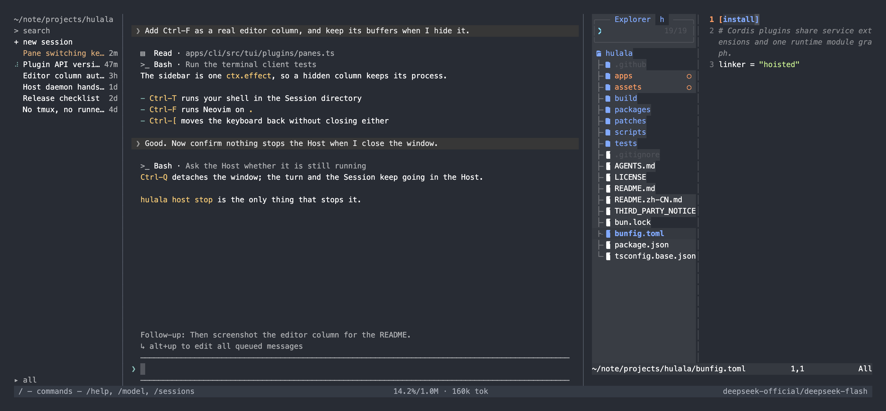
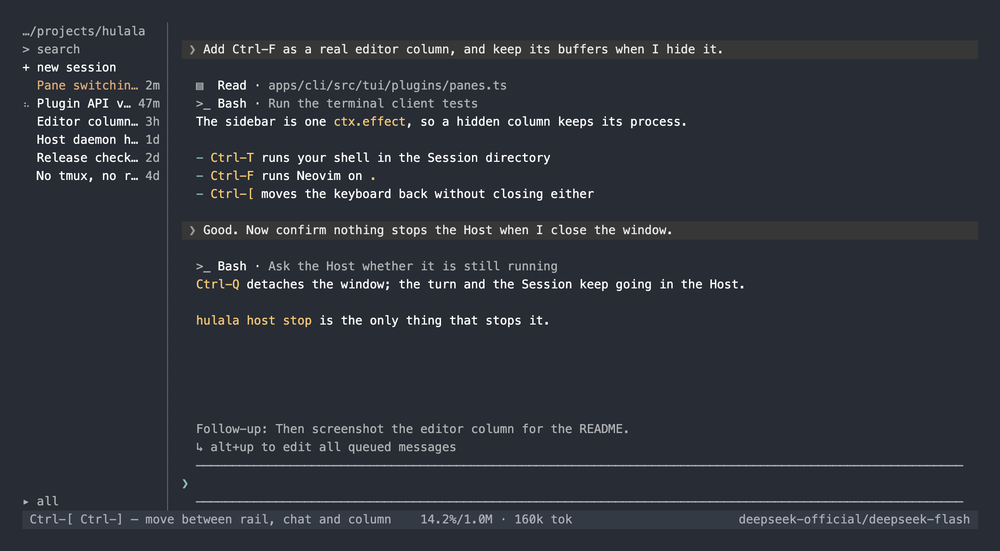
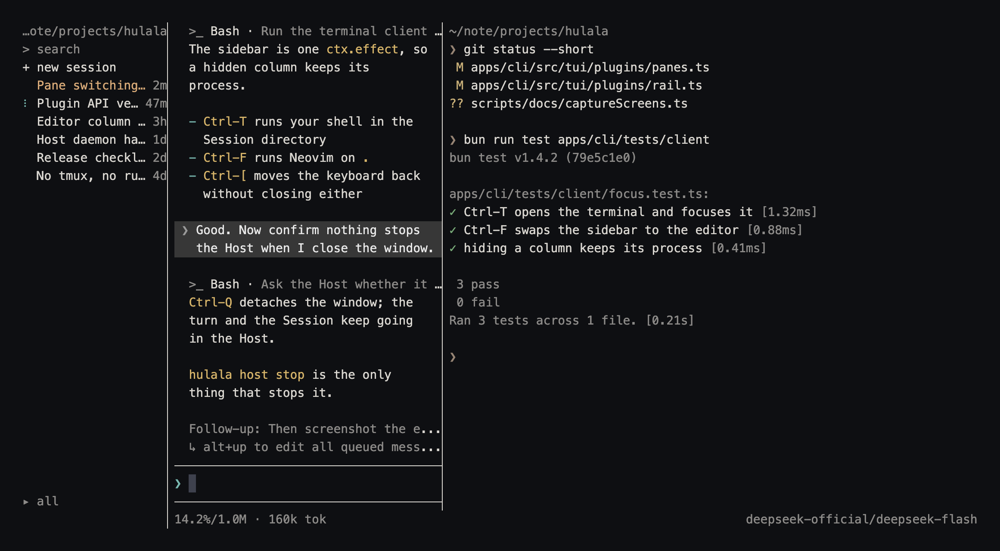

<div align="center">
  
  <h1>Hulala</h1>
  <p>面向 hacker 的 DeepSeek Harness。</p>
  <p>一个 TUI：内置 Neovim、真实 shell，还有一个你永远不用看着的守护进程。</p>
  <p><a href="README.md">English</a> · <a href="https://hulala.ai/zh-CN/">官网</a></p>
</div>

Hulala 把 [DeepSeek Harness](https://github.com/deepseek-ai/deepseek-harness) 放进终端，
并把整个客户端交给你：引擎就是 DSH 自己的 Agent Loop，每个面板都是插件，agent 还能
给它自己跑在里面的这个客户端写插件。

<p align="center">
  
  <br />
  <sub><code>Ctrl-F</code>：在会话目录上打开 Neovim——内置文件树、从树里打开的文件，列隐藏时缓冲区还在。</sub>
</p>

`Ctrl-F` 是在会话目录上打开编辑器，所以它同时也是文件树：内置的浏览器
（`apps/cli/vendor/snacks.nvim`）替代了 netrw，选中文件就在同一列里、树的旁边打开。

<p align="center">
  
  <br />
  <sub>整个帧：左侧会话栏、带工具行的对话、排队的消息和下面的 composer。</sub>
</p>

## 特性

- **一个窗口三列** —— 左边会话栏，中间对话，右边一个侧栏：`Ctrl+T` 是内置终端，
  `Ctrl+F` 是 Neovim。
- **不需要 tmux，也不需要启动脚本** —— Host 本身就是守护进程。每个窗口都是连到它的
  客户端，`Ctrl-Q` 只是断开，turn 继续跑。
- **自带 Neovim 和 ripgrep** —— 什么都不用装。每个内置二进制都是 `$HULALA_HOME/bin`
  下的真实文件，`bin/` 是追加到子进程 `PATH` 的，所以你自己装的工具仍然优先。
- **会话目录里的真实 shell** —— 右列是一个完整 pty；列收起来，作业和缓冲区都还在。
- **用的是 Harness 原生面，不是抄一套** —— 流式输出、审批、提问、选模型、取消，以及
  `/connect`、`/api`、`/api/remote.mux`。
- **插件就是一个 `.mjs` 文件** —— `hulala plugin new|check|list|disable`，没有构建步骤，
  没有 `node_modules`。
- **Creator mode** —— agent 拿到客户端自己 Cordis 面的只读视图和检查它的工具，于是它
  能给自己跑在里面的这个客户端写插件。

## 不需要 tmux

`hulala` 不是那种每个窗口启动一个、关窗就没了的程序。一个 Host 守护进程拥有状态根目录；
每个终端窗口都是连到那个进程的客户端，想开几个开几个。

```sh
hulala host start        # 这个状态根目录唯一的 Host，detached
hulala                   # 附着窗口 —— 开几个终端都行
hulala host status       # 守护进程现在的状态
hulala host stop         # 唯一能停掉它的东西
```

客户端通过状态根目录里的 `endpoint.json` 找到守护进程，所以健康的 Host 在响应时，
第二个窗口不会偷偷起一个自己的。关窗（`Ctrl-Q`）只是断开：模型调用、工具调用和
Session 都还在跑，下个窗口接着停的地方继续。`tmux`、`nohup`、裸 `&` 就是在手搜这件事；
这里是程序默认的行为，而 `hulala host stop` 是明确的终止方式。

<p align="center">
  
  <br />
  <sub><code>Ctrl-T</code>：内置终端——会话目录里你自己的 shell，带自己的回滚历史。</sub>
</p>


## 快捷键

整个帧不靠鼠标也能用：

| 按键 | 作用 |
|---|---|
| `Ctrl-T` | 在右列打开内置终端；再按一次关掉 |
| `Ctrl-F` | 在同一列打开 Neovim；再按一次关掉（未保存的缓冲区会先问你） |
| `Ctrl-[` / `Ctrl-]` | 在会话栏、对话和已画出的列之间移动键盘 |
| `Ctrl-G` | 显示或收起会话栏 |
| `Ctrl-D` | 列打开时把对话收起来 |
| `Ctrl-Q` | 断开：窗口关掉，Host 把 turn 继续跑完 |
| `Esc` | 停掉正在跑的 turn；没有在跑时，进入会话栏 |
| `Ctrl-C` | 停掉正在跑的 turn；composer 空闲时先清空草稿，再按一次退出 |
| `Enter` | 发送；turn 在跑时用 `Alt-Enter` 排成下一个 turn |
| `Alt-Up` | 把排队的消息取回 composer |
| `Ctrl-O` | 展开当前指向的工具行 |
| `Ctrl-S` | 立刻写编辑器缓冲区（平时自动保存） |
| `Shift-PgUp` / `Shift-PgDn` | 翻终端列自己的历史 |
| `↑` `↓` `j` `k` `Ctrl-P` `Ctrl-N` | 在列表里移动；`Tab` 补全，`Enter` 打开 |
| `/` | 命令：`/help`、`/sessions`、`/new`、`/model`、`/editor`、`/terminal`、`/cancel`、`/quit` |

客户端里输入 `/help` 会印出同一张表——如果你的终端或输入法吃掉了某个键，以它为准。

底部是一条横贯全宽的栏：左边滚动播放用法提示，中间是上下文和 token 读数，右边是
模型名；当前工作目录在会话栏顶端。

## 客户端

**终端** —— `hulala` 连接本机 Host（没有就 detached 启动一个），打开终端客户端：

```sh
hulala                              # 终端客户端
hulala --resume <session-id>        # 继续一个已有 Session
hulala update                       # 安装最新版本
hulala update --check               # 只看不装
```

终端内输入 `/help` 查看命令：Session、prompt、流式输出、审批、提问、模型选择和取消。

**官网** —— `apps/website` 是公开下载站，不内嵌 Agent Runtime。

## 一切皆插件

一个窗口就是一个 Cordis `Context`，kernel 之上没有什么是写死的。kernel
（`apps/cli/src/tui/kernel.ts`）只拥有 `Context` 本身和它的销毁；其余每个功能都是
`apps/cli/src/tui/plugins/` 下的插件：

```text
kernel            Context 创建、插件装载、销毁
lifecycle         关闭标志
viewModel         Host 事件折成 transcript 条目
terminal          终端设备、屏幕、键位表
render            帧循环与它的同步步
layout            帧：七个座位、列宽、焦点
editor            内置编辑器：发布、环境、标记文件
panes             右列：pty 里的一个程序
composer          输入行，以及选择器借用那个 dock 槽
overlays          审批、提问、选择器、键盘持有
session           打开的 Session、它的目录、模型和 follow 流
rail              Session 列表列
view              transcript 与 dock 各行
commands          斜杠命令与 prompt 投递
input             唯一的输入管线
update            版本提示与换版
user              用户插件的装载器
```

座位是封闭集合——`main`、`dock.pending`、`dock.cwd`、`dock.input`、`dock.status`、
`rail`、`pane`——而且座位只声明**内容，永远不声明几何**。列宽、最小值和窄终端规则
都留在帧那边。

因为客户端就是这些插件拼出来的，一个功能可以换掉而不碰邻居，故障也是隔离的：某个
插件无法激活、或者它的 `render` 抛错，代价只是它自己那几行。

### 自己写插件

一个插件就是一个目录里一个普通的 `.mjs`。它不 import 任何东西——整个 API 作为
`activate` 的参数传进来——所以不需要构建步骤，也不需要 `node_modules`。

```sh
hulala plugin new hello      # 写入 ~/.hulala/config/plugins/hello/
hulala plugin check hello    # 校验它，并渲染它注册的每一个座位
hulala plugin list           # 装了什么，哪些被关掉了
hulala plugin disable hello  # 停止加载，但不删除
```

```js
/** @param {import('@hulala/plugin-sdk').PluginApi} tui */
export function activate(tui) {
  tui.command('hello', '打个招呼', () => { tui.notice('hello') })
  return tui.seat('dock.status', { id: 'hello' }, {
    render: width => [`hello from ${width} columns`],
  })
}
```

契约在 `packages/tui-plugin`，并且**只增不减**：同一 API 版本内可以加字段，不会改变
已有字段的含义。目标 API 版本超出客户端实现的插件，会在加载时按名字被拒绝，消息里
带着两个版本号。

没有沙箱。插件是普通的 ESM，拿着客户端自己的权限。只从你会直接运行的来源安装。

## Creator mode

默认关闭。打开之后，Host 会多一份自己 Cordis 面的只读视图，agent 拿到检查它的工具
——于是 agent 可以给你的终端客户端写插件。上面那句话在这里是字面意思：你正在对话的
东西，能扩展你正在打字的东西。

```sh
hulala creator on     # 然后 hulala host stop，让 Host 带着它重启
hulala creator status
hulala creator off    # 把这项能力从组合里移除
```

开关是 `<状态根目录>/config/creator.json`。关掉时会从已有 profile 里删掉那些行——
能力是消失，不是闲置。

## 安装

```sh
curl -fsSL https://hulala.ai/install.sh | sh
```

然后在任意终端：

```sh
hulala                  # 连上本机的 Host
hulala update           # 装最新版本
hulala update --check   # 只看不装
hulala rollback         # 回到上一个版本
hulala host stop        # 停掉守护进程（唯一能停掉它的东西）
```

支持 `darwin-arm64`、`darwin-x64`、`linux-x64`、`linux-arm64`。Windows 尚未实现。
Neovim 是包里自带的；Node.js 不是。`install.sh` 先用机器上已有的 Node.js 24.9+，
没有就问你要不要装一个：Homebrew、`apt-get`、`apk` 能提供 24.9+ 就用它们，否则
从 nodejs.org 下载经过 SHA-256 校验的独立包，解到 `$HULALA_HOME/runtime/node`。
管道安装且没有终端时它不会擅自改动机器，而是停下来说明缺什么。下载这一侧专门照顾网络差的机器：
安装器会读 macOS（`scutil`）或 GNOME（`gsettings`）的系统代理并只对自己的下载生效，`nodejs.org`
不通时依次退到 npmmirror、清华、腾讯的 Node.js 镜像，并且认 `HTTPS_PROXY`、`HULALA_NODE_BASE`、
`HULALA_NODE_LINE` 三个环境变量。

Hulala 写的一切都在 `$HULALA_HOME`（默认 `~/.hulala`）下：`config/`、`desktop/`、
`server/`、`runtime/`、`logs/`、`cache/`、`transfers/`、`bin/`。安装器在这个目录之外
只写一个链接：你 `PATH` 里已有目录中的 `hulala` 命令；不传 `--add-to-path` 就不改
任何 shell 配置文件。如果 Node 是安装器装的，它就在 `runtime/node/` 下，`hulala`
命令直接从那里启动它，所以从未得知该目录的 shell 里也能用。

发布包的目录结构（运行时和依赖都不在包里）：

```text
hulala-<version>-<target>/
  bin/hulala                 Node CLI 与终端客户端
  bin/nvim                   内置 Neovim（runtime tree 在 runtime/editor/ 下）
  bin/ime                    macOS 输入法辅助（仅 darwin 目标）
  server/hulala-host.mjs     Host wrapper
  runtime/host.mjs           编译后的 Host
  runtime/package.json       本发布解析出来的依赖清单
  runtime/package-lock.json  在你机器上执行 `npm ci` 用的 lock
  runtime/editor/            Neovim runtime、tree-sitter parsers、snacks.nvim
  manifest.json
```

归档只有约 10MB，因为它不带 `node_modules`：`hulala install` 按发布版的 npm lock 装依赖；
npm 或 registry 不通时，装旁边发布的、已经打好 patch 的
`hulala-<version>-<target>-runtime.tar.gz`。DSH 的 `dsh-office-to-pdf` 背后的 LibreOffice
引擎完全不下发：解压 140MB，而终端客户端没有文档转换功能。打包时会剪掉它，并把打包后的
Host 真正启动一次，证明其余依赖仍然可用。

包里每个二进制都是真正的文件，绝不是软链：安装器把它们复制进 `$HULALA_HOME/bin`，
升级后第一次打开编辑器时客户端会再发布一次（编辑器的运行数据落在
`$HULALA_HOME/runtime/editor/`）。`rg` 也用同样方式从 Harness 自己为 `grep` 工具装的
`@vscode/ripgrep` 发布出来，所以编辑器的 picker、以及模型通过 `bash` 跑的任何东西都
不需要机器上装了 ripgrep；那个目录是**追加**到子进程 `PATH` 的，所以已安装的 `rg`
仍然优先。

终端列和编辑器列共用同一个侧栏：只显示画出来的那一个，另一个的进程不会因此结束。
列隐藏时进程一律保留，所以 shell 作业和 Neovim 缓冲区都还在。按键见
[快捷键](#快捷键)，完整规则见 `apps/cli/README.md`。

macOS 上每个面板拿到键盘时都会把输入法切成英文（`com.apple.keylayout.ABC`）：左侧
会话列表（含它的过滤框）、编辑器列、终端列，因为这些面板把按键当程序输入。composer
永远不自动切，你在那里选的是什么就是什么（包括手动切到中文）。切换用的 `bin/ime`
由发布包提供；从源码运行时第一次启动会从 `apps/cli/native/ime.c` 编译出来。

## 从源码运行

使用 Bun 1.4.2 和 Node.js 24+。Host 运行在 Node 上，因为 DeepSeek Harness 通过 Node
内部模块加载器启动。

```sh
git clone https://github.com/colinagent/hulala.git
cd hulala
bun install --frozen-lockfile
bun run build
bun run start
```

常用命令：

```sh
bun run check           # check:patches → typecheck → test → build
bun run check:patches   # 证明每个 patchedDependencies 条目确实被应用
bun run typecheck
bun run test
bun run host:build
bun run website:build
```

`check:patches` 排第一是刻意的。`patchedDependencies` 的键是**精确版本号**；键对不上时
bun 会静默忽略补丁，产物里装的是没打补丁的上游文件。这个检查断言已装版本与键一致，
并且补丁新增的每一行都在已装文件里。

## 目录

```text
apps/cli       终端客户端、插件宿主、程序生命周期
apps/server    Hulala Host 守护进程壳（DSH webServer + connection）
apps/website   官网和下载元数据
packages/runtime             DSH 组合（一个原生 Agent Loop）
packages/host-client         发现、detached 启动、共享客户端契约
packages/desktop-contracts   Host/client 线协议与状态根目录路径
packages/tui-plugin          终端客户端插件契约
packages/distribution        安装、更新与回滚
```

## 许可证

Hulala 第一方代码采用 GPL-3.0-only。第三方组件保留各自许可证，见
`THIRD_PARTY_NOTICES.md`。
