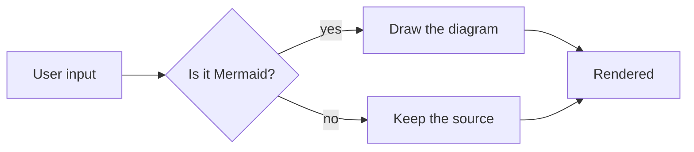

# Hulala Markdown Rendering Sample

This page checks headings, lists, tables, code blocks and Mermaid in one pass. The
English screenshots on the website are taken from here, so each section stands on
its own and can be captured separately.

## 1. Heading levels

### Third level

#### Fourth level

##### Fifth level

## 2. Bullet lists

- First level: a bullet
  - Second level: nested
    - Third level: indented far enough to show the glyph cycle
      - Fourth level: deeper still
- First level: another item
  1. Second level switches to numbers
  2. Another numbered item
     - Third level is a bullet again

## 3. Numbered lists

1. First level
   1. Second level
      1. Third level
      2. Another third-level item
   2. Another second-level item
2. Another first-level item

## 4. Task list

- [ ] Not done
- [x] Done
  - [x] Nested and done

## 5. Tables

| Command | What it does | Notes |
|:-----|:----:|-----:|
| `<Space>um` | Toggle rendering | Per buffer |
| `:RenderMarkdown` | Plugin command | Global |
| `gx` | Open a link | Needs netrw |

Columns are measured in display width, so a wide glyph costs two columns:

| Item | Description | Supported |
|---|---|---|
| Table | Alignment with mixed content | Yes |
| Inline code | `render.setup({})` | Yes |
| Link | [Upstream](https://github.com/MeanderingProgrammer/render-markdown.nvim) | Yes |
| Long word | `supercalifragilisticexpialidocious_identifier_name` | Yes |

## 6. Code blocks

```lua
local ok, render = pcall(require, "render-markdown")
if ok then
  render.setup({ file_types = { "markdown" } })
end
```

```ts
export function render(file: string): number {
  return file.length
}
```

```
A fenced block without a language
```

## 7. Mermaid



## 8. Everything else

> A quote keeps its bar in the gutter and wraps like body text.

- Inline code `const x = 1`
- **Bold**, *italic*, ~~strikethrough~~
- Horizontal rule:

---

## 9. Wrapping

An unbroken English paragraph does the same job for words: the renderer has to
break between words, never inside one, and a word longer than the column has to
overflow rather than vanish. This sentence keeps going so the paragraph is long
enough to wrap at every width worth testing, including a narrow editor column.

`a_very_long_inline_code_span_that_should_wrap_or_overflow_predictably` is also a width test.

Footnote test[^1].

[^1]: This only matters to renderers that support footnotes.
