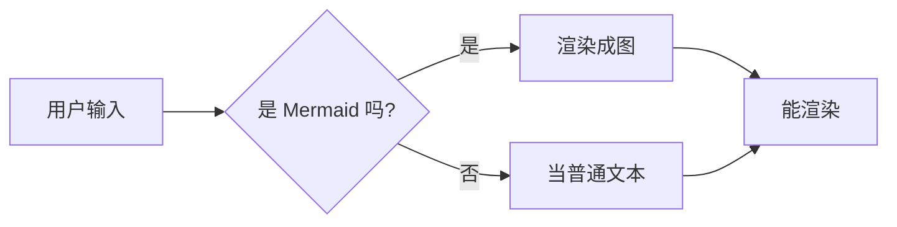

# Hulala Markdown 渲染测试

这个页面用来检查标题、列表、表格、代码块与 Mermaid 的显示效果。官网中文版的截图取自
这里，所以每一节都保持独立，方便单独截取。

## 1. 标题层级

### 三级标题

#### 四级标题

##### 五级标题

## 2. 无序列表

- 第一层：项目符号
  - 第二层：嵌套
    - 第三层：再嵌套一层，用来观察缩进与符号变化
      - 第四层：再深一层
- 第一层：另一个条目
  1. 第二层改成有序
  2. 第二个有序项
     - 第三层又是无序

## 3. 有序列表

1. 第一层
   1. 第二层
      1. 第三层
      2. 第三层的第二项
   2. 第二层第二项
2. 第一层第二项

## 4. 任务列表

- [ ] 未完成
- [x] 已完成
  - [x] 嵌套的已完成项

## 5. 表格

| 命令 | 作用 | 备注 |
|:-----|:----:|-----:|
| `<Space>um` | 切换渲染 | 按 buffer |
| `:RenderMarkdown` | 插件命令 | 全局 |
| `gx` | 打开链接 | 需要 netrw |

中文的列宽按显示宽度计算，一个汉字占两列：

| 项目 | 描述 | 是否支持 |
|---|---|---|
| 表格 | 中文列宽与对齐 | 是 |
| 行内代码 | `render.setup({})` | 是 |
| 链接 | [上游仓库](https://github.com/MeanderingProgrammer/render-markdown.nvim) | 是 |
| 长单词 | `supercalifragilisticexpialidocious_identifier_name` | 是 |

## 6. 代码块

```lua
local ok, render = pcall(require, "render-markdown")
if ok then
  render.setup({ file_types = { "markdown" } })
end
```

```ts
export function render(file: string): number {
  return file.length
}
```

```
没有语言标记的代码块
```

## 7. Mermaid



## 8. 其他

> 引用块：用来观察左侧竖线与换行。

- 行内代码 `const x = 1`
- **粗体**、*斜体*、~~删除线~~
- 分隔线：

---

## 9. 换行

一段没有换行符的中文长句，用来观察软换行在窄列里的断行位置：编辑器列通常不会很宽，
所以一段长的中文说明会在窗口边缘折行，折行之后行首不应该出现多余的缩进或错位。

`a_very_long_inline_code_span_that_should_wrap_or_overflow_predictably` 也是一个宽度测试。

脚注测试[^1]。

[^1]: 这一点只在支持脚注的渲染器里有意义。
